# 实习季度述职报告

*“一条指令执行的时间是10的-10次方秒，四个月的实习的时间是10的7次方秒，我在新江湾的办公大楼里消耗的是后者，发起执行的是前者” ——孙语新编* 

## 引言
在四个月之前，写了过去的一年到入职之后我都经历了些什么。四个月过得飞快，天气凉了又热，热了又凉。从坐飞机到上海开始再到坐飞机从上海离开，或许我一直都会记得这段回忆。我想把这些记忆用文字写下，如果在我未来有一天重新看到这篇文章，能够让当时的片刻场景重新出现在眼前时，便是现在落笔的意义。

## 开始的记忆
6月6日，在确定了入职之后，我乘坐飞机从长沙到了上海。此时的大楼和办公位置对于我来说仅仅只是一串文字，一个标记着我未来几个月会一直呆在的地方。非常幸运的是我有家人在上海，于是从租房到入住很多东西都受了非常大的帮助（非常感谢呀）。面对连租房怎么找到房源都不清楚，并且时间比较紧急（在长沙的时候是用了很久的时间来线下找房的，这一套对于上海不适用）的情况下，在自如上随便找了一个住了进去*（正规但是避雷，只能签长租并且过程中退租收的违约金巨大，房源的价格很高，如果是合租的话舍友素质属于开比较烂的盲盒）* ，一个大小不到10平米的小房间就成了我在上海实习期间暂时的避风港。

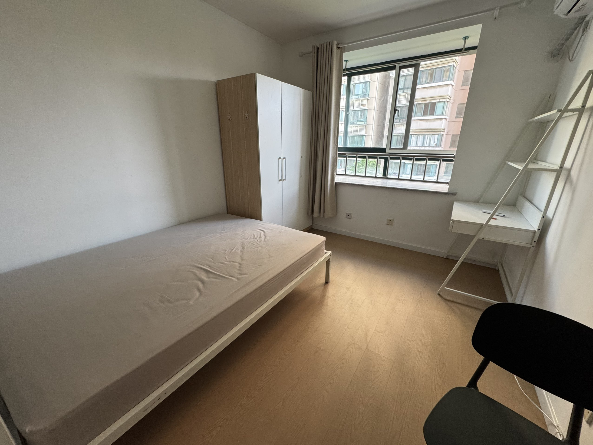

最开始时房间里约等于什么也没有。只有最基础的柜子、床，和一张桌子。所有的床上用品和生活用品都需要自己一个一个买。但是因为最开始买的床上用品质量并不好，所以最开始的两周住的很不舒服。比如枕头的质量很差，被子很薄不好盖之类的。并且回到出租房之后，除了玩电脑和玩手机，就再也没有别的活动。生活非常枯燥和无聊。后来我买了更好（其实是更贵）的被子和枕头，然后把我的投影仪也带到了上海来，睡觉前躺在床上打开投影仪追一集番剧，这才让下班后的生活舒服了起来。

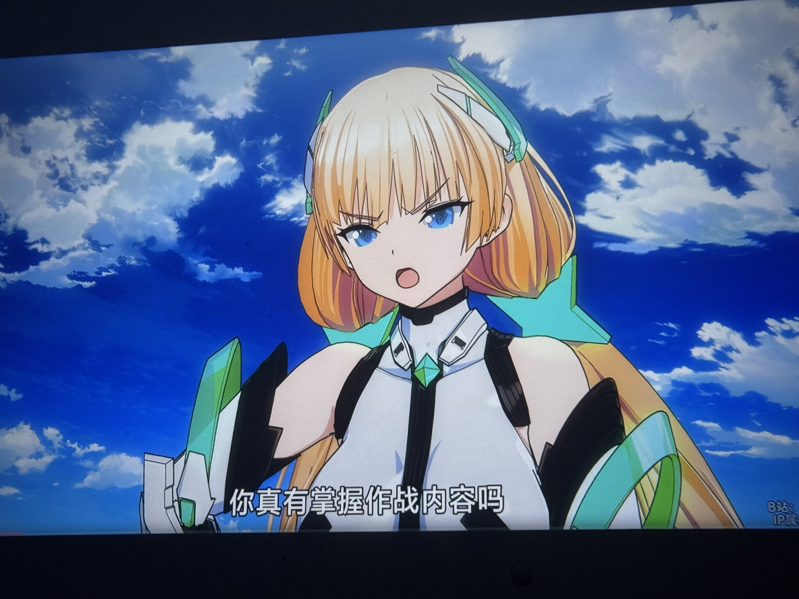

6月10日，到了入职的日子，按照短信要求，在十点的时候准时到了新江湾的t4楼。我从正门口进去，从右侧的楼梯走上二楼。看到有一些人和我一样，在向过道上坐着看上去像是负责签到的同学询问，拿签到报道相关的纸。我跟上去也拿到了一张，扫了二维码，然后进门走到培训室里。房间里早已经坐了非常多形形色色的人，他们都是今天来入职的。然后便是走流程了：听培训的人讲公司相关的内容，看墙上电视播放的公司文化视频，然后是it拿着一堆笔记本进来，领取入职礼包，领取电脑，领取临时工牌，初始化电脑……做完这一切之后便结束了培训。我像一个小学刚入学的一年级学生，背上背着一个书包装着刚领到的办公电脑，手上拎着一袋入职刚发的大礼包，然后走出t4的大门，看着广场上来来往往的人群，想着我也是一个大厂的实习生了。脑子里不断想着之后会是什么样，工作当中的大家会是什么样，我的带教是否会像xhs说到的那样出现“mean”的情况，我的领导是否会像网上说到的那样“不近人情”“压榨”等情况，上班的压力是否会非常大出现996/10105那样。这么想着不知不觉中走到了t2的门口。进去之后坐在电梯入口旁边的休息区座位上，等待着有人来带我上去。

然后我的带教来了，我跟着他进了电梯，走到办公区，和部门里各个同事打招呼，然后坐到座位上，便开始工作了。

说实话，在最开始进到办公区，看到刷刷刷一排又一排的电脑，我确认自己走进了和网上经常看到的那样真实的办公区域了。空间里此起彼伏的声音和声音中的内容提醒着我这就是最真实的办公环境，我们大众用的app的服务有很多就在这里维护、开发。坐到椅子上，打开电脑，接收到第一篇文档，进入第一个群聊，无尽的信息洪流便开始向我的大脑和认知发起冲击。文档里有很多东西是我熟悉的，但更多的东西是我从来没见过的。这些专业的名词缩写充斥着文档。对于一个第一次实习的学生来说未免有点负载过大了。晚上写完新人日报，从公司门口出来的时候，意识还没缓过神来。第一天就这样结束了。

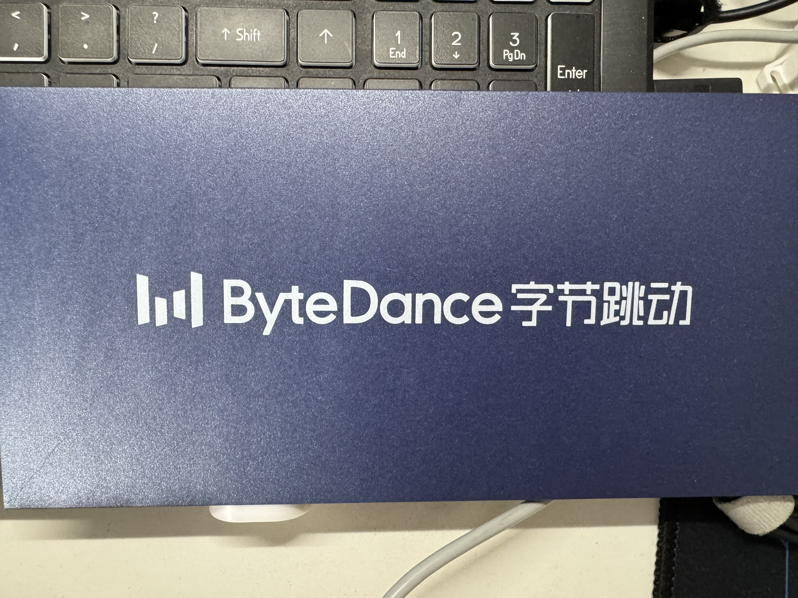

之后的时间就像开始了神父的加速一样，很多的时间都坐在工位上，同时并发处理4~5个任务，不知不觉一天就会这样结束。

## 在工位上的一天
上班的日子一般都比较枯燥。早上九点钟从床上爬起来，骑上共享单车，15分钟到办公楼下。坐电梯上到5/7层吃个早餐，然后到我的工位上放下电脑开始工作。在此之前，我习惯拿上我的两个水杯，去茶水间一个装一杯冰美式，一个装一杯浓的离谱的红茶，上个厕所，再慢慢悠悠的回到工位上，打开公司内的技术论坛看看最新的热榜文章（虽然现在很多都是）。上午的时间大家一般都比较晚才到。有些时候早上有会议那么就基本到中午吃饭为止就都在开会。说来也好笑，作为实习生，基本所有的会和我都关系不大，开会的时候经常只是需要到场挂个名字在会议当中。然后听与不听取决于自己想不想要听。只有我们自己的小团队开会的时候确定要听。有时候任务比较紧，早上以来就会开始记录任务，执行任务，把任务派发给ai，然后让ai基本执行每个具体的细节，然后派发结束之后就去派发下一个任务或者查看ai给出结论的任务做出下一步指引。又或者自己去调研探索，查看任务的一些ai难以触碰到的内容。总结来说，早上基本上10点到达工位，然后和mt确定一天的任务或者对齐一下进度，又或者是开会，是一天的plan阶段。

最开始的时候，工位不够所以和mt坐的距离很远，当时非常多东西不清楚怎么使用，或者说不知道该怎么做，经常就会在飞书上和mt提问，但是很多时候因为社恐所以经常不敢问。虽然后来和mt聊天的时候说这样确实没有必要，他反而还希望实习生能够多多汇报当前进度和不懂的东西。另一方面在飞书上的效率也不够高，于是我记得当时经常准备一堆问题，然后端着个电脑走到mt的工位边上，直接面对面开始问。再后来工位调整，我做到了mt的旁边，并且随着时间增加对工作内容也熟悉了，所以在后面问的没有那么多。更多的时候时对齐任务进度和一些想法和需求的讨论。<!--  -->

到了后面两个月的时候，习惯了工作到11点之后放下手头的内容前往厕所史遁。这里不得不吐槽字节的厕所是真的少。一层的员工差不多100号人，但是一层的坑就三个，更何况里面的人喜欢在里面磨磨蹭蹭不出来，经常一等就是15~20分钟，然后才有一个人慢慢悠悠的冲水，打开门，从厕所里打开门出来。当我的肠胃真的很急，在向括约肌抗议的时候，等待那扇不知道何时才会打开的门的时间似乎就过的格外的慢。*（打工牛马苦snp久矣）*

到了中午12点便准备到公司食堂吃饭了。不过一般来说会是12点15分才开始出发。一般吃什么都在前往食堂的路上才决定好。字节的食堂还是菜系、种类非常多的。在上班的四个月过程中成功的把去年减下来的肥肉全部涨回来了…… 回来之后便是休息到下午两点。中午1点左右的时候还经常会有别的人在讨论工作相关的问题。不过更多数是坐在椅子上玩手机or看电脑。接着声音会逐渐安静。大家都会开始午休。对于我来说午休确实是必要的。在那个环境当中有可能睡着，但是能够睡着又不太可能。上班过了一个月，我买了U型枕和眼罩，但是瘫坐在椅子上总是不能够让椅子靠背和我的背贴合，于是躺在椅子上也不一定睡的下去。于是切换方法，回到小学时午休的方式，趴在桌面上尝试着睡觉。这样的效果确实是好一些，但是对应的眼睛、手臂和背，在睡了起来之后便会遭了殃。更多的情况下午休会陷入一种似睡非睡的情况，那种感觉就是差一点点就会睡着，大脑开始不自觉地开始想一些奇奇怪怪的事情，在坠入睡眠之海的前一刹那意识又会把人拉回来，但是又不是非常的清醒。大部分出于这样的情况。然后不知道过了多久一看时间，1点45了。然后开始起来，准备开始下午的内容。在开始之前我一般又会去茶水间补充我上午喝完的一杯冰美式和把已经泡过一轮的茶包续上慢慢一壶的水。

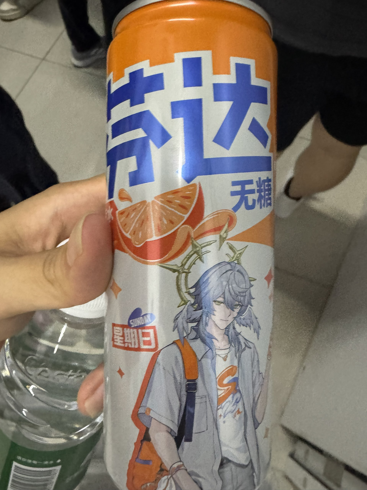
_*我宣布mhy占领bytedance*_

我记得有些时候中午都会比较忙。有一次和别的部门的团队合作，我得跟着mt一起对接开会。于是那一天中午1点到2点开了一个小时的会，整个下午感觉毫无动力和精神。

下午一般就是最忙的时候，一直execute上午的plan。有时候还会经常有更加紧急的任务进来打断。有时候做着这个a，然后突然进来那个b，那个要去看b任务内容开始执行，执行到一半又会回到原来的a处理反馈。然后mt提起来昨天的任务c还得再改改。于是下午化身为演奏乐器的汤姆猫，“做完你的做你的，做完你的再做你的”。浏览器页面开了一个又一个，终端界面不断跳动着agent处理工作输出的内容和调用的工具，电脑发烫，手心冒汗，不时来一会儿电脑散热风扇传来的呼呼伴奏，又或者是周围同事上班时讨论工作的白噪背景声。手腕上的手表抬起便是一个小时过去，但是任务又发现了新的问题。比如调用下游的问题，网络配置的问题，代码历史遗留问题，新设计的功能稳定性问题……在处理过程中，会不自觉的把手伸到放在电脑边的杯子——先伸到装咖啡的杯子，有就喝一口，发现没有了，就摇一摇杯身，听听杯子里冰块和不锈钢杯壁碰撞发出喀拉喀拉的撞击声。然后把装咖啡的杯子放下去拿装茶的杯子。然后就这样经常水喝的太多了，导致基本每过一个小时就会去上一次厕所——这是任务处理过程中的紧张、疲劳和膀胱神经传导到大脑的共同杰作。

在不断execute这个过程中，太阳就把金光从洒在漫天，变成洒在从落地窗外看去外面的大楼上，在楼的墙壁上画出菱角分明的色块区域，一边是墙壁本身的白色，一边是太阳光的颜色——到后来又变的金红，又逐渐深下来，变得深沉了。这时候对面t3楼的荧屏的光又会闪起来，在窗户上投下一轮一轮光晕。夜幕降临，天黑了。

然后便是晚饭。和中午类似，也是走相同的流程。这时候基本准备要开始收尾一天的工作内容。我经常和mt在吃饭排队时聊天，打趣道，人其实是agent loop当中的一环罢了。所有人被agent套着在工位上。生怕agent没有运行任务。到最后发现人反倒被ai牵着鼻子走了:ai停下来，人便得看，便得从输出的一系列token里找到和任务有关的信息，然后判断是否跑偏了，再发出新的命令——总之ai不能停。

吃完晚饭之后，回到工位上，又继续做做我的内容。但是一半来说七点半左右就差不多结束了，然后把今天的内容总结一下，写一下新人日报（新人日报我最终写了72天，每天都写，应该是整个部门写的最多的人了哈哈哈哈），最终合上电脑，开溜。不记得是什么时候开始的，我也养成了把电脑带回家的习惯hhh。

离开办公楼之后。有一段时间我经常回到对面的t1楼的健身房运动。先是热热身，在跑步机上run个4km，然后去练练背练练臂。最后用仰卧起坐收尾。这时候出来一般就是9点~9点半了。

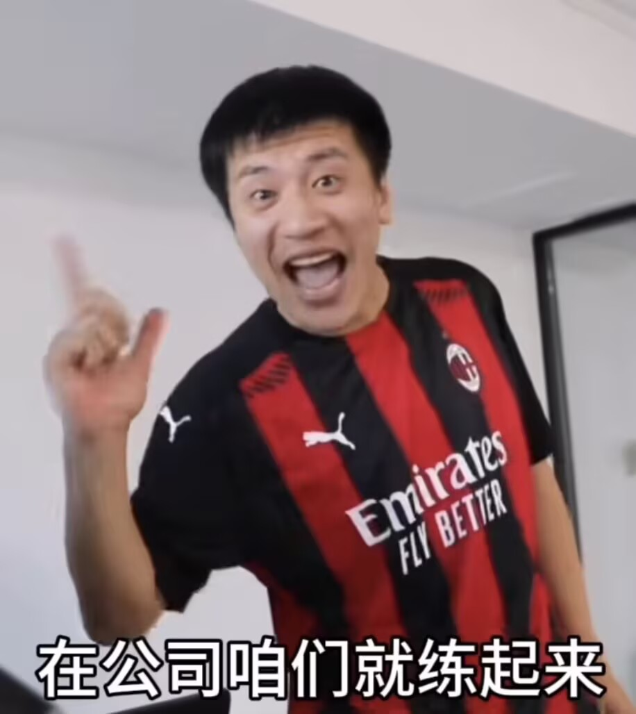
从六月到七月，又从八月到九月，回到出租房前的最后一条小区道路上凉了又热，热了又凉，到了十月的时候已经经常吹起呼呼的风了。它穿过墙边的灌木丛，让绿叶遮挡夜间的路灯，投下一丛又一丛光斑。发出的声响奏着秋天的歌。回到家一般10点，随便洗洗澡，收拾下卫生，玩玩电脑，就12点~1点了。于是一头睡死过去，一睁眼又是这一章节的开始，开启新的重复的一天。

## 摸鱼のtime
上班时间总不可能全部时间都在上班干正活的，那样会累死的，于是在一些期间必须要摸鱼来给自己缓冲一下（其实也没摸多久就是）。一般来说因为第一次实习还不够老油条，所以其实并不是那么敢明目张胆的摸。更多的时候是打开公司的技术论坛查看有没有感兴趣的文章和感兴趣的技术分享。说实话看这个其实也同样的非常耗费精神，但是相比于干活而言反倒是没有那么劳累。与此同时，在工位上摸鱼并不会去看抖音、B站等视频网站，因为那样太明显，虽然之前我看到和我一样的peer这么做过，挂着直播听音乐啥的。更多的摸鱼时间除了看技术论坛之外，在浏览器上看GitHub的项目、看看各大科技公司的比如anthropic、typesafe之类的公司网站和一些ai相关的网页比如openrouter等。更多的面向文字阅读。*（被问起来我就说在做技术探索更好的实现功能，虽然基本没有被抓到过也其实没有人抓）* 因为实习生访问公司的字节圈需要向领导申请权限，由于本人比较社恐所以其实并没有向领导申请，因此失去了一大乐趣。据说上面的内容不限于：男女拳打擂台撕逼，闹到对方+1+2无限制格斗、女生发信息男生在下面发评论，男的改昵称为“这个我是真喜欢”，在一个美女的一系列自拍照下点赞+呼朋引伴，评论里@昵称为“有好看的cc我”的朋友并留言说“P0”、“P00”。还有的摸鱼时间花在各个公司内部员工之间的交流讨论群，主要是讨论ai和agent，经常被最新出的大模型做出的效果吓到“震惊瘫坐，仿佛看到了核弹爆炸”。对opus 5.5，gpt6 astra最初的印象便来自于那些群里有同事分享的相关作品示例。

除此之外，我一直想要做一个能够深入的我的生活，自己从零开始手动构建的agent。之前使用langchain和langgraph搭建的demo过程中发现受约束性很多，比如自定义钩子的自由程度不高，没有办法很好的自由管理上下文，对于agent的处理和工具的定义使用比较困难，graph图在执行上比较死板。在上班时有一个好处时无限量高速的免费高质token可以使用，于是我尝试着开始了解agent运行的底层，然后开始自己搭建一个agent出来。我想把这个agent赋予更多的能力，未来的目标是至少能够融入到我自己的生活当中，帮我去查看，去记录，去发现和提醒我。我把这个项目叫做icarus。在上班的时候，当任务都派发出去了，没有可以短暂处理的内容时，我就会打开这个项目，然后开始讨论着我构思的代码和功能。

在公司上班不可不谈论的福利当然是团建内容。只可惜我在作为实习生的时候，七月中旬领导就在群里征集大家去哪里团建的意见。据mt说，这次规模很大，三天两夜。要去的地方是山东青岛看海，或者去内蒙古看草原，又或者是上海和北京大家各过各的，到时候统一报销。我倒是都挺想去的。更多的是我想借此更多的认识一下团队不在上海的同事们，幻想着拿我买的相机去记录团建时的风景与快乐的瞬间。为此我专门买了很多相机的配件：uv镜、装uv镜的包、清洁器等。甚至为了快递可能不能够在可能的出发日期前到来而着急。那一个月的每一周都很期待，希望着领导能够发一个“这周五去”之类的消息。就这样一个又一个周五就这样过去了。大家逐渐忙了起来，似乎都把这件事情忘了。投票之后，公司的绩效开始考评了，新的一个季度的okr又开始讨论了，团队主要做的项目开始大力推进推广了……期待中那样的消息再也没有更新的出现。期待一起出去旅游的心思也随着一周一周的过去而放下了。

当然虽然没有公司部门统一的出去旅游，但是还是有聚餐的。那时刚好有新的同事加入了我们的部门，有些在海外的同事临时来到上海我们这里出差。领导原本去到北京/深圳的飞机，修改计划来到上海和大家一起聚一下。那天下午我的mt突然和我说，今晚上不在这里吃饭了。我没放在心上，当作有一个他和他的npy出去吃饭的原因。看我如此反应，他进一步说，是咱们都不用在公司吃饭了。那时埋在6个任务当中，处理的无法自拔的我突然似乎眼里有了光，一个下午的劳累和心里的阴霾突然就被一扫而空了。也是那一天我第一次线下见到了我的领导长什么样，说着什么话。话说挂不得是领导，说起话来气力十足，做起事来雷厉风行。

那天的六点随着领导向大家招呼着去吃饭后，我们都站起身来，从公司的楼梯间一层层走下去。我mt和另一个在上海的我们团队的同事围着领导走下楼梯，想着t1的定好的餐厅走去，我跟在mt的后面，在其他团队的同事之前，夹在中间，插不上话，只能跟着向前走，途中遇到领导问我点关于我的问题，尽我自己所能回答的礼貌得体（实则大脑宕机）。那天去吃的饭店叫做Latina，一家巴西烤肉，像小时候我爸妈带着我去和他们的重要客户应酬一样（别问为啥我也会去，问就是对方叫的是一家人来hhh），坐在饭桌上既拘谨又腼腆，同时还要装出一副很大方、礼貌、热情的样子。服务员带着一杆烤肉过来帮忙着夹着切下来的肉，然后把这些切好的肉分发到对应的碟子当中。假装优雅但是耐不住肉实在是太好吃了。

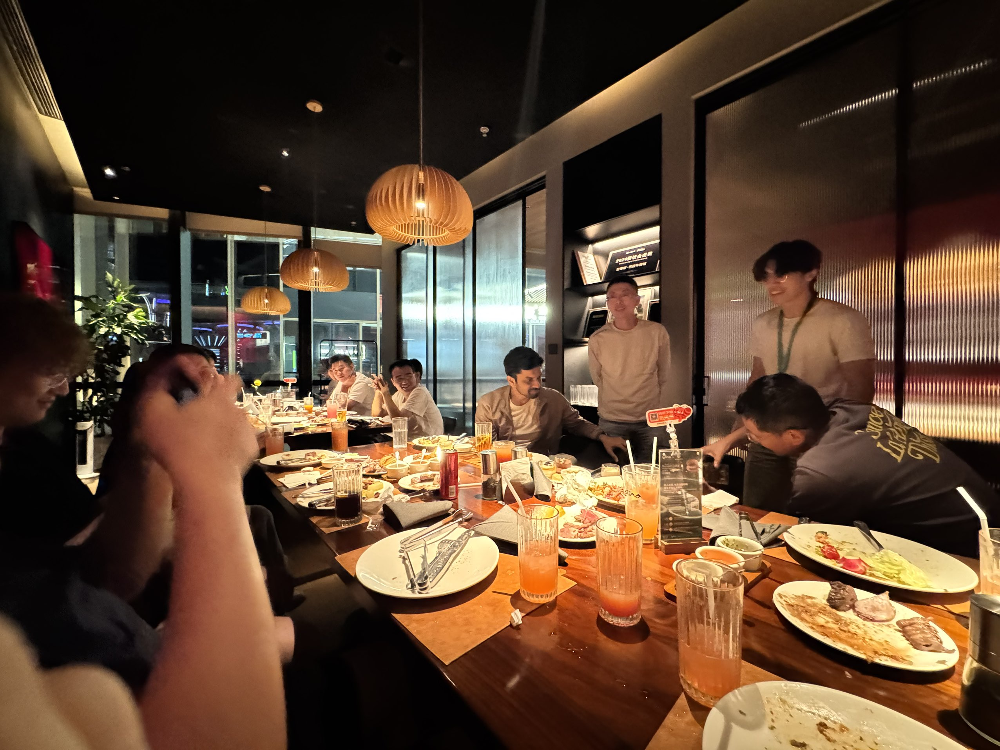

饭桌上领导问我是不是大四已经没有课了，就出来实习。我笑笑，并没说我其实是大三的，而是说着其实是偷偷跑出来的，领导知道后大为惊讶。

最后大家一起合了张照片作为纪念~
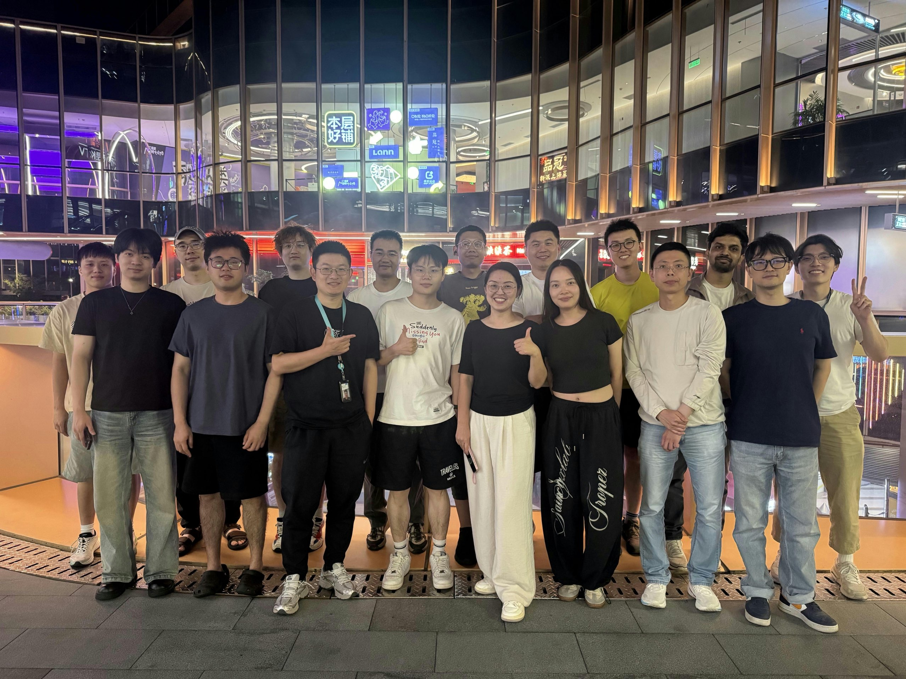

记得七月还是八月中旬上海有台风，台风天的前一天晚上飞书发来了可居家办公的通知。但是一想到我呆在家里还要上班，三餐（其实是两餐）和水电费还要自己付钱，同时办公体验还是仅仅只在那台公司发的mac上，一想到公司一来肯定没人，二来屏幕空调茶水全部基本免费，于是毅然决然选择依旧到公司上班。说来奇怪，大家都不在之后平常热闹的工作群全部都安静了，又或者是对于我来说也基本没有人找我了。我坐在的工位那一排甚至周围6~7排就只有我一个人。耍起！东边茶水间猛猛拿咖啡茶叶灌零食水果；中间男厕所快乐享受不用排队想蹲多久蹲多久的坑位；楼下饭堂里东挑西挑不用排队任意窗口胡吃海塞；坐在工位上享受2*27寸4k大屏加无人看管肆意摸鱼。外面风雨交加，鼓点般的雨滴打在窗户玻璃上，仿佛回到了高中大雨时学校没有上课时的教室里。

## 放假与双休
其实说是上了四个月的班，但是实际上双休、假期、请假这三个加起来，实际上班的时间很少，据我自己记录应该是在70天左右上班的时间。

双休去做什么了？大多数时候对于我而言应该是这样的。周五晚上睡觉前打开投影仪看上一集这周更新的新番（比如尼古喵喵、恶女不才、碧蓝之海、记忆管理局等），又或者熬个大夜看上一个剧场版（乐园追放）。第二天早上睡个懒觉，然后起来做点自己喜欢做的事情，又或者无所事事，享受着这难得的片刻闲暇。

要说真去做什么事情的话，那应该是这些了：给我的博客写写一些文章，讲讲最近看的番剧、了解到的技术之类的；打开icarus项目开始开发，尝试着添加新的功能；又或者给房间收拾一下卫生，把衣服、书籍、生活用品之类的都整理一下，放到它本应该在的位置，用扫把和拖把把房间的地板扫一下拖一下，把上面的脏东西灰尘发丝碎屑啥的一扫而空。如果天气好，又有空，那么会尝试着出门到周边去看看：最简单的是到周围两个大学里去看看，然后就是骑着共享自行车在家里、公司周围漫无目的的骑着。再者就是到五角场那里去，到那几个大商场里看看有没有新东西。等到夜幕降临，华灯初上的时候，回到大学路去看看，两边店铺的门面透出的灯光和熙熙攘攘的人群让我似乎有了一些活人的感觉，有时候大学路上会有一些活动或者展览，我记得我当时看到的有两个，一个是以西瓜为主题的，一个是以功夫为主题的。道路上两边支起店铺，去查看每个店铺时就好像冒险开盲盒——或许会开到有意思的东西，忍不住用眼光在商品上多多把玩两下，如果开到的东西烂大街，那么就会直接路过

有时候精力比较充沛，那么就会尝试着出趟远门，到浦东新区那些繁华的商业区去citywalk，顺便带上我的相机，也许会在有灵感的时候端起来抓拍两张（虽然实际上基本就是个负重的存在hhh）。然后经常是刚下地铁就开始犯困，到了热闹的地方就开始头脑发晕犯困，强撑着走完全程，从拥挤的人群中挤回到地铁上，回到家里，然后哐当一屁股坐在椅子上，任由困意冲击大脑，筋疲力尽。

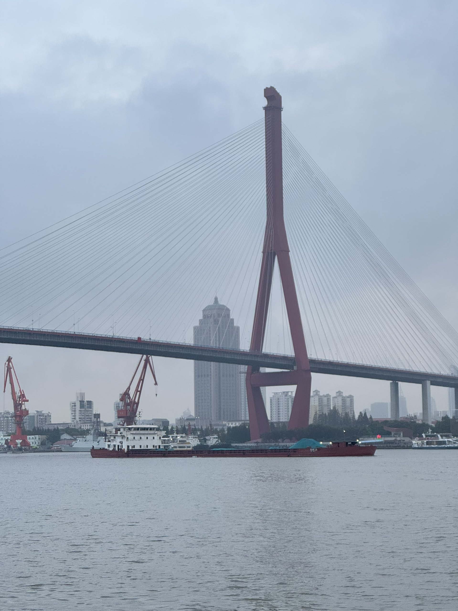
*这个是黄浦江边上的杨浦大桥*

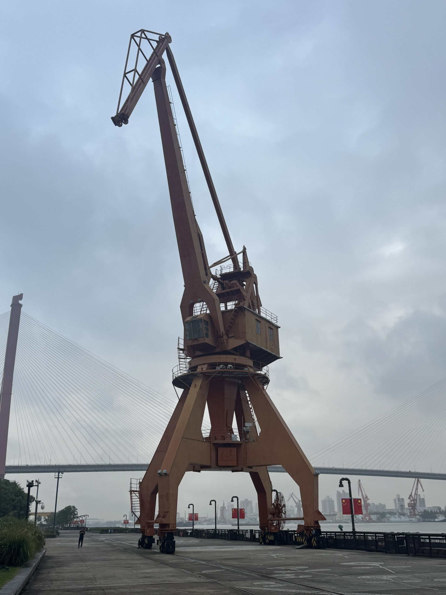
*这个是江边已经变成建筑物的塔*

假期和请假都是在一起的，用于把它们连起来处理一下家里或者学校的事情。在端午的时候，把假期和中间的工作日一起请了起来，用来回学校考期末考，也正是那一次回来上海，我把很多用于改善生活体验的东西拿到了上海的出租房里，让之后的生活体验更好。国庆和中秋则是回到了我一年多没回到的广东的家，一年多的时间让我回到那里时，有一种熟悉而又陌生的感觉。眼前所见的东西都和记忆当中有所不同，过去十几年那些曾经被封尘的记忆又开始提高权重在我的大脑工作区当中。如果用一句话来形容就是眼前的东西是陌生的，但是身体却能自己行动，看到对应的东西能够自动想起来关于这件物品的内容，就好像不属于自己的记忆被注入了一样。

给大家分享一下飞机上的云海~
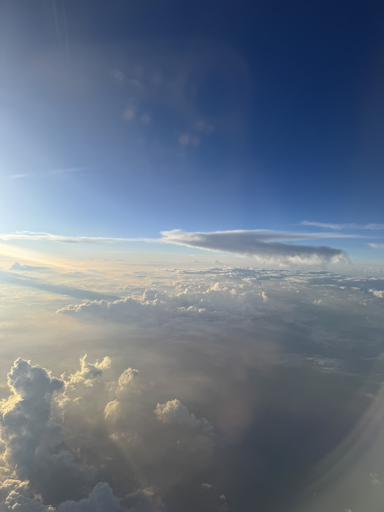

## 离开的时候
在九月份开学的时候，或者说九月份开始的时候，离职的想法就开始疯狂充斥我的大脑，当时时不时就会想起我不想干了的念头。确实也是，当时的想法本就是6月初到9月初就结束，当我意识到这个念头在我的头脑里疯狂踊跃了一周的时候，我就知道是时候该开始准备走了。我提前了一个月和我的mt说明了我要离职的时间（先是告诉他会在十月中，然后过了两周告诉他确定的具体的时间），于是工作的内容就从这个时候开始收尾。

九月三十的时候在飞书上正式提交了离职申请    。

十月国庆回来之后最后的两天上班将所有的内容清理收尾打包，并写相关的文档，包括总结和我做的东西的交接文档。把开发的应用权限给到mt，把文档的所有权给到mt，把我做的东西总结然后放到我的脑子里，公司文档带不出去，会被追责，甚至连有关的操作都会被限制。

在离职前我看到大家的氛围都挺好的，于是我想着给大家都送点小礼物，经过家里人的建议我给其余的同事送了非常好玩的礼物——刮刮乐，为了看上去稍微再丰富一些，我还去零食店买了巧克力。离职前两天突然想到不太可能空着这些就这样送过去，于是下班之后赶紧到了五角场的muji买了糖果和简单的纸袋，虽然纸袋是最小的了，但是最终东西一装的时候还是看上去比较空，于是当时给同事发礼物时只能抱歉的打哈哈说没办法了只能买到这么大的纸袋了哈哈哈。对于mt则是在国庆之前就想好回广东时带一些当地特产了，最后结合各种情况（比如在和mt闲聊的时候透露出的喜好、吃饭时聊天提到mt的家乡是哪里、个人的情况、自己的经济状况等）决定了送一饼茶叶给他。

在lastday上，把背包装满了东西，在10点40才慢慢悠悠的到了公司工位上，接着就开始最后的文档交接，把所有的有用的文档都交给了mt，包括总结和我做的东西的交接文档。在和mt最终确认之后，就开始走正式的流程了：先是交还返回公司资产——那两个4k的显示器，以及当时入职时发放的mac电脑，但是鼠标、键盘、耳机就不在返还的内容当中，自己可以带走。返还之后桌面基本空了，这时候把尚未分装的礼物从包里拿出来，放到桌面上摊开开始打包，我记得打包了16份。至于我部门有多少人，在当时团建聚餐的时候就注意过了，按照那个时候来准备，不可避免的或者必要的多准备了3~4份，多了总比少了好。然后一排一排的一个一个送过去。令我惊喜的是大家态度都很好，丝毫没有出现我害怕的不收的情况。或者说没有表现出来hhh，我觉得我送给大家的礼物应该已经差不多了，再贵就没有必要，应该不会有人嫌寒酸把？（QAQ）我很惊喜竟然有人问我是不是要回长沙了，竟然记得我的学校在长沙，竟然记得一个实习生的信息哈哈哈。我以为我只是一个可有可无的人。

做完这个就到了12点，和mt去了t4楼，吃了一顿无限量的麻辣烫，聊了很多东西，从去哪里旅游，到团队的过去和公司的现状，又到了未来职业的前景和看法，吃完之后到了楼下的咖啡厅，进行了最后一次one one，相互加了微信。最后起身的时候把礼物给了他。我很庆幸第一次实习能够遇到这么好的mt，那一次的咖啡本来我准备请的，但是拗不过他的盛情，只能恭敬不如从命。

最后从差不多到了一点半，最后到行政确认了一下全部流程，从前台确认完后离开。走出公司大门的一刻我拍了照片，记录了那一个瞬间。下午的太阳刚好很亮但是又不至于刺眼。走出公司的那一刻竟觉得出奇的轻松。最后一次下班我选择了走路回家，每走到一段路上我就举起我的手机拍照，记录下这将来可能会回来也有可能再也不会踏上的道路的画像，证明我1曾经来过这个地方。

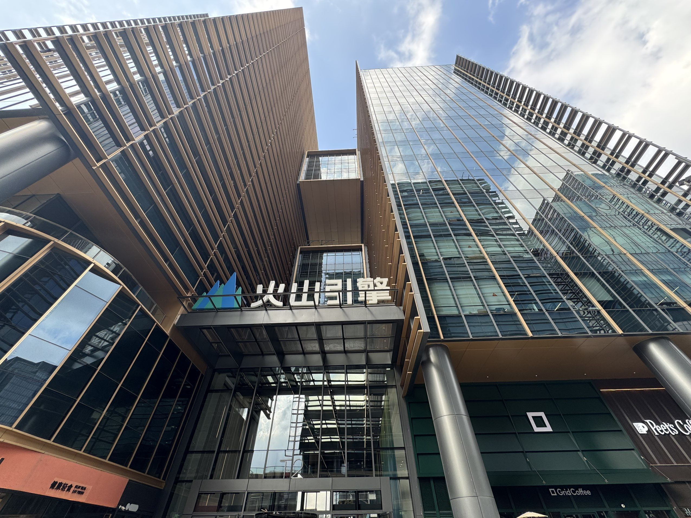
*我工作的楼栋*

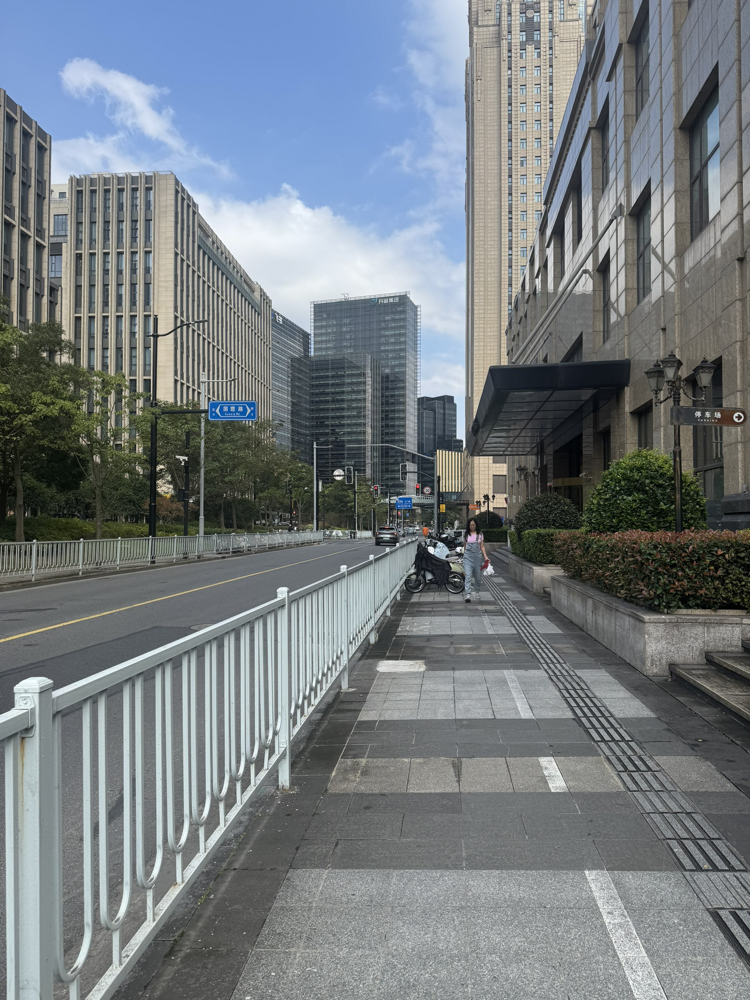
*我几乎每天都会从这里经过去到公司地点*

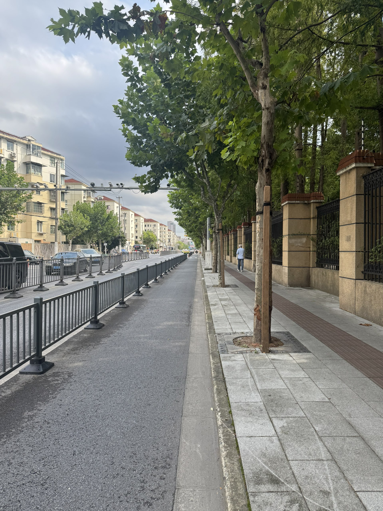
*这里是从上财旁边的道路，去到公司的必经之路*

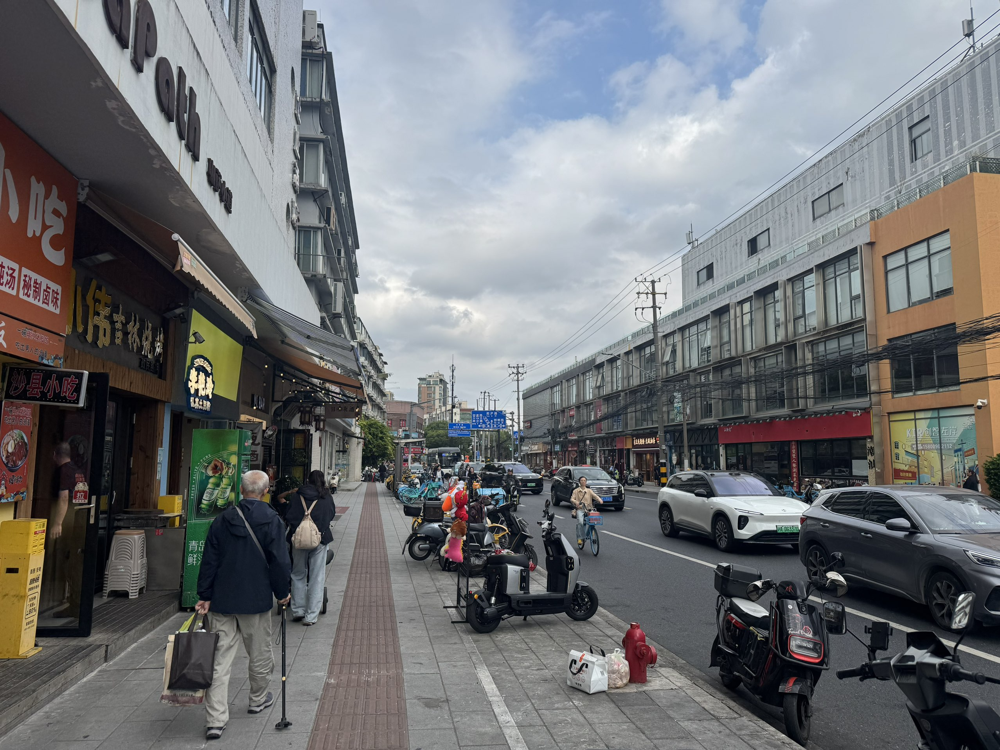
*这里是出来之后，能够去到大学路的道路*

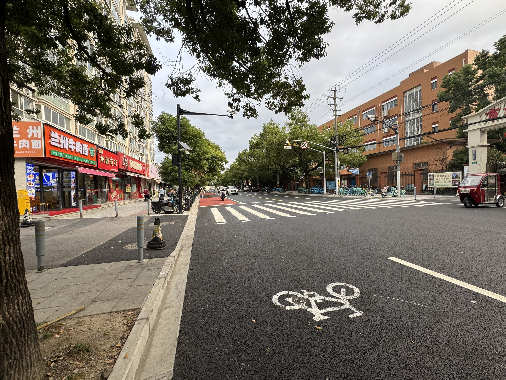
*这是我家门口的小路哈哈哈*

回到家之后，便是打包所有要带走的东西，让快递员上门把东西带走，收拾完之后看最后一眼我曾经在这里呆过四个月的小房间，看着它又变回了原来刚搬进来的样子，提起我的行李箱，关上门，离开。第二天便乘坐飞机回到学校。

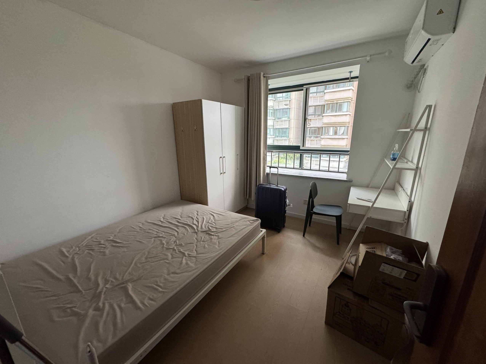
*东西都收拾完寄走之后，似乎和刚来的时候就是一样的，基本没有什么变化*

这么算来，在这段时间里，我坐的飞机的次数竟然有六次，手上的登机牌都没扔掉，现在集合到一起发现都能摆成一个小扇子的样子。再次尝试打开飞书，发现账号已经不存在了。我的第一次实习就这样结束了。
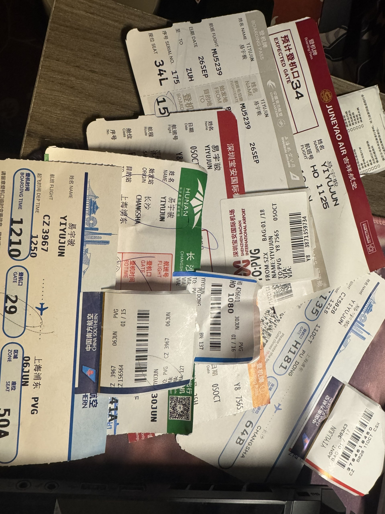

## 想说些什么
在回来之前我曾经这样告诉过自己，回来之后我要好好在学校躺两个月，但是当我了解到大家这个学期都开始努力，为了成绩、读研杀的你死我活的时候，我就在想，我回去之后是否真的还能心安理得的躺上那么两个月吗？之后的情况又会是什么样子的呢？大厂的经历也同样给我带来了提问：你真的想要以后过上那样的日子吗？早上睡醒了就是上班，下班了就是睡觉，完全没有任何个人的生活时间，和魔鬼签订契约，用生命换来金钱。

离开上海前的那天晚上，有同学又告诉我，我们年级也已经陆陆续续的有人开始出来，和我一样到外面实习了。我的焦虑的心似乎又开始被影响，开始变得躁动不安，想要影响我的生活了。我以后会去到那里？下一步的任务和目标又是什么？我到底想要做什么？一年前甚至半年前的我想不到自己会到字节跳动中实习，那么半年甚至一年之后，我又会是什么样？

有时候我坐在工位上，脑子里又会想，我自己当前做的工作是否有价值？是否对未来有更好的作用？但是到了后面我又觉得一切都没有必要，顺其自然就好。我已经做了我最大的努力了。*（以后秋招找不到工作我就说大环境不好，不然大环境好我也不会这么卷，忆昔当年计算机全盛日，再视如今，不禁嗟叹~）*

但是至少有一点我能确定，做自己喜欢做的事情就好，我想把icarus做好做大做完善，让它能够加入到我的生活当中，并对我的生活、学习、工作产生帮助。然后用开发它的经验与能力，去锚定我未来的方向。回到学校之后我有了更多的时间能够做我自己感兴趣的事情，探索自己感兴趣的内容了。过程中顺便打打基础，把前后端框架、语言、算法都做得更好更加牢固，看看包括llm在内的深度学习，同时看兴趣去学习学校的课程，努力着有所收获，同时不要忘了多去了解ai领域的最新消息和知识。或许就是这样吧。

在这段实习之后，偶然在看一个长视频时发现一个观点：我们需要的，并不一定是我们想要的，我们想要的，也不一定是我们需要的。但是我们需要什么，是我们需要付出长时间的探索才能确定的，而我们想要的则在当下的欲望当中就能知道。“需要”对于我们来说有着更多的更重要的现实含义，“想要”则随着我们的行动、对外界的观察和反应，不断的向我们的“需要”靠近。

## 结语
不知道写什么结束好，或许生活就是这样，没有一场轰轰烈烈的退场，只有平平淡淡的平滑淡出。就好像在离职时一起去和咖啡的时候，我和mt说到下一次，如果有下一次的话，一定要是我来请客。但是是否真的会有下一次，有的话又在什么时候，是否还会记起来，谁也不知道。原本在上班的时候都想着我要写一个惊天动地的文章出来好好表达一下我的感受，但是每次想要动笔写的时候又总是觉得不够清晰不知道怎么写，时间的大手又把情感的波澜抚平，逐渐变得说不出话来，写不下字去。总而言之，希望自己能够在实习和学习的过程中不断的找到自己，做自己，成为自己想要成为的样子，做自己喜欢做，能对大家有帮助的事情吧。

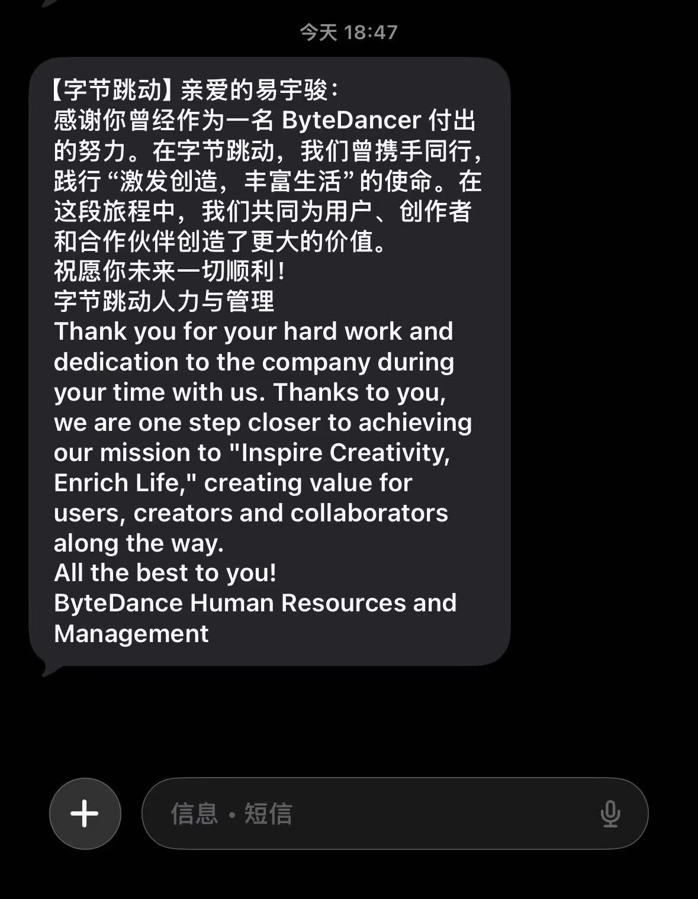

**完~**