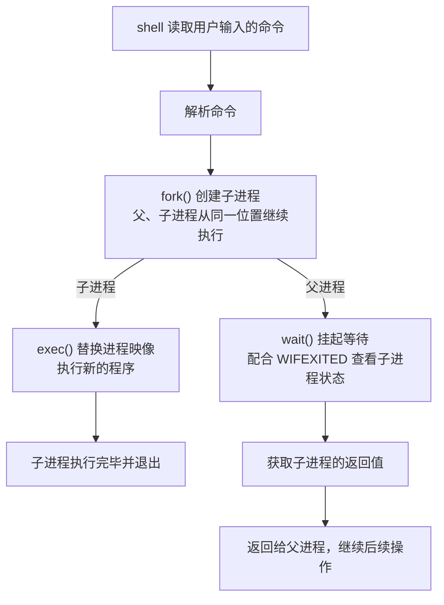
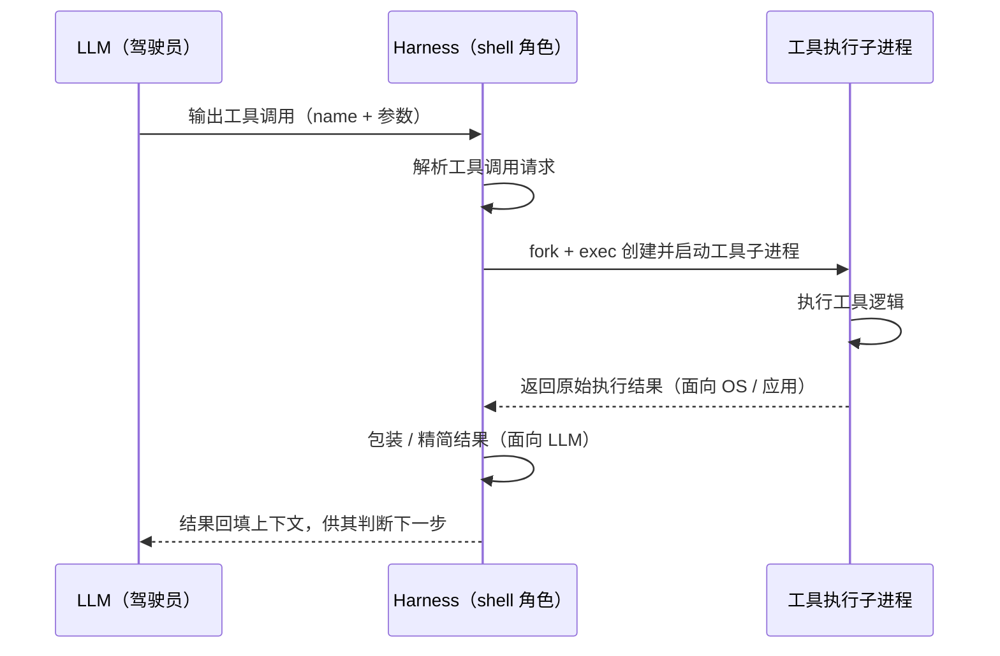
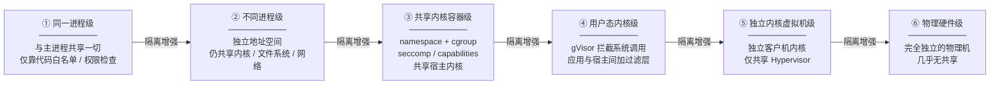
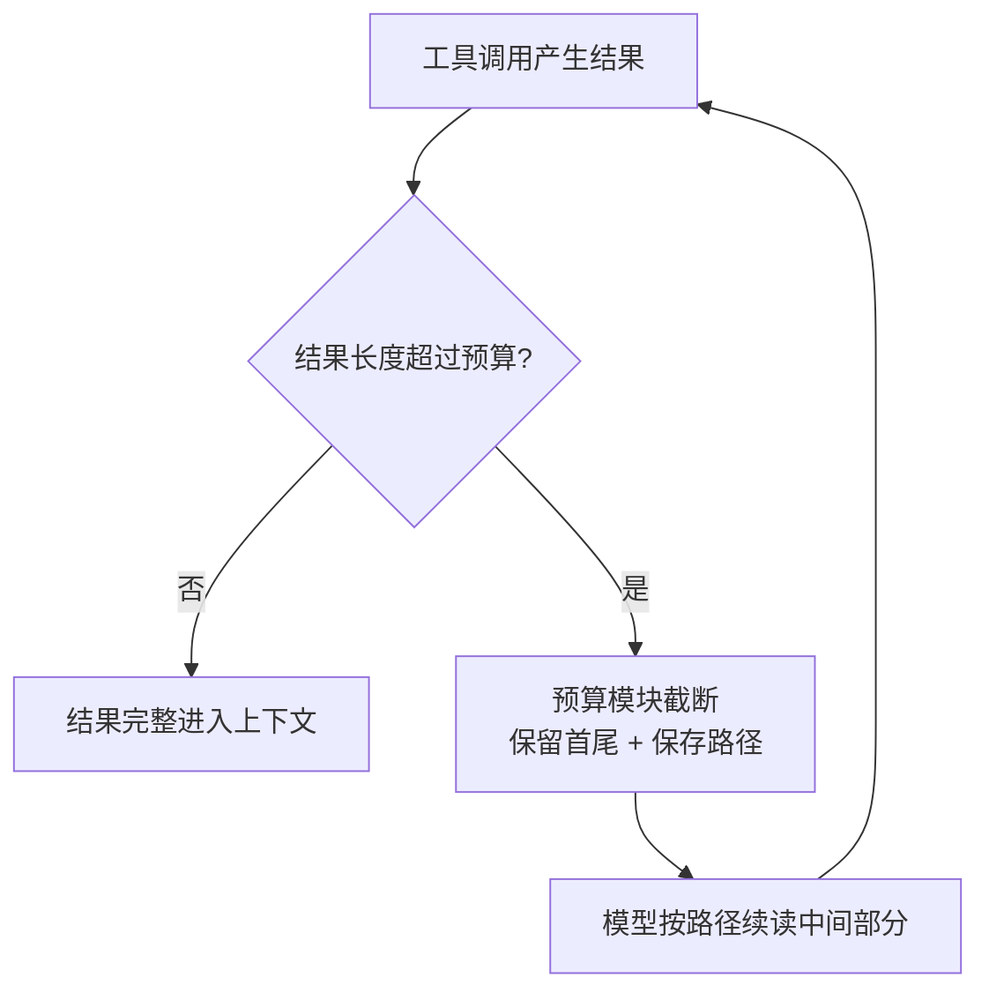
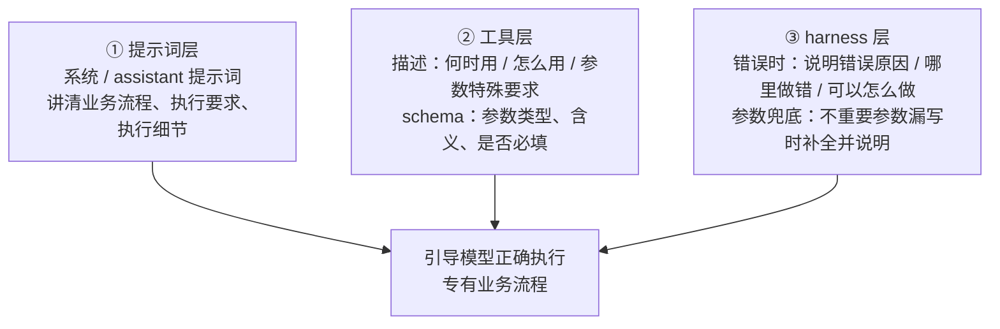

*Modelus dixit: "Fiat manus." Et factum est instrumentum. Viditque Modelus instrumentum bonum esse, et separavit ambitum a contextu.——《模经 · 眩晕瘫坐纪》1:3–4*

*封面本质上也是辉夜姬用手这个工具完成代码编写任务*

>注：本文使用代码层讲解实例基于openai的api协议。其他协议的实现方式可能会有差异。这里仅作为参考。若未指明协议，默认为openai的api协议。

叠甲：可能有不准确的地方，欢迎指正。

## 一、引言
从模型的最开始，其只是作为chatbot存在，并不具备和外部世界交互的能力。我们只能在某个界面和模型发起一句又一句的你来我往的对话。随着模型智能化程度的提高，我们尝试让模型在接收任务的情况下，通过“手脚”和外部世界关联，那么这个手脚就是工具调用，于是agent出现了。在人工智能导论当中，agent被定义为传感器感知环境、感知序列做决策、执行器对环境施加作用的交互系统。因此从这里看来，我们日常生活中谈论到的agent从更加准确的描述来说应该是ai agent/llm agent。对于这类agent而言，工具成为了其执行器的具体承载者。

那么在大多数人看来，模型调用工具似乎是一件非常简单的事情，体现在页面上就是弹出一行文字，然后告诉你现在模型正在调用工具。实际上，模型进行工具调用的过程远比想想的复杂。那么这篇文章就是想要详细的讨论关于以agent调用工具为核心的一系列问题与细节。

## 二、模型使用的概论
首先我们要明白一个概念：agent=llm+harness。也就是说，我们现在常看到的模型，其实都是这两个内容组成的。如果把agent看作一台高达，llm即驱动agent这台高达的驾驶员、harness则是这台高达的机械部分。而工具调用则是llm向harness告诉说它要执行的内容，再有本地的harness进行解析、处理、执行、返回结果。具体的流程如下：
1. llm通过harness给的信息看到了关于当前工具tool的描述和使用方法+当前正在执行的上下文
2. llm输出关于当前工具执行的响应并由harness接收
3. harness解析llm输出，确定其要执行什么工具
4. harness在本地执行工具
5. harness将本地执行工具的结果处理好，添加到上下文中，再返回给llm
6. 回到第一步，循环直到llm认为当前任务已经解决了。

oh我的朋友，这看上去实在是太简单了！但是落到代码处细节又该是一副什么样的风景呢？那么我们在下面来详细聊聊这些内容。实在是非常的有意思。

## 三、工具调用的流程

### 3.1 工具的创建
创建工具其实是一件非常简单的事情。理论上来说，该工具其实只需要是一段清晰的描述，并注入到上下文当中，模型就能看到并根据当前的情况尝试进行工具调用。

对于工具的创建，我们需要先进行工具的定义。一般来说，我们想要模型能够正确优秀的执行一个工具，那么我们会在工具的定义中提供以下的字段：
| 字段key | 字段val | 作用 |
| ----- | ----- | ----- |
| name | demo_echo | 用于向llm表示这个工具叫什么名字 |
| description | 回显一段文本。截断时用 next_offset 续读，不要跳过正文。 | 对于这个工具的作用的描述 |
| schema | 一段json | 工具调用的参数 |

示例如下：
```python 
def definition(self) -> ToolDefinition:
        return ToolDefinition(
            name="demo_echo",           
            description="回显一段文本。截断时用 next_offset 续读，不要跳过正文。",
            input_schema={
                "type": "object",       
                "properties": {"text": {"type": "string", "minLength": 1}},
                "required": ["text"], 
            },
        )
```
description一般需要短小而精悍，不宜过多的描述。并且保证其功能尽可能单一。schema当中一般要写明白工具的调用参数的类型、作用、是否必须等，便于llm进行理解和处理。

在pi agent当中，使用了一种核心思想为：只用最简单的工具，不造复杂的工具。这样便于llm理解的同时也利于人的维护。在pi agent的核心当中，只创建并使用了最简单的四种工具：
1. read：查看某类文件
2. write：把文本等内容写入到文件中
3. insert：将文本插入到文件的指定位置
4. bash：类似于windows的cmd、linux的shell等，执行一段bash指令

通过这四个工具，pi agent即可实现绝大部分的工作。在coding场景下效果非常好。一方面来说其避免了llm的认知负担，模型天然对这几个工具熟悉并且能够熟练的使用，同时也避免了工具的复杂化导致的维护成本过高的问题。

这样我们其实就完成了工具的创建。有人也许会问，工具的创建明明都没有一个正儿八经的处理方法，你这就算工具创建了？实际上，我们或许并不需要在代码上僵化模型的工具代码定义。工具的描述注入与处理执行是分开的。核心在于llm输入和输出的内容能否被正确的理解与解析。至于其原理在下面会详细地讲到。

### 3.2 工具的暴露与 Schema 注入
那么我们既然已经做好了对于一个工具的描述，那么我们该如何让模型知道有这个工具呢？我们先来看看模型执行对话的核心——上下文的结构：

```text
        ┌──────────────────────────────────────────┐
        │  ① tool description   ← 工具描述 + schema │
        ├──────────────────────────────────────────┤
        │  ② system prompt        ┐                │
        │  ③ assistant prompt     ├─ 统一为         │
        │  ④ tool prompt          |   history      │
        │  ⑤ user prompt          ┘   messages     │
        │                                          │
        └──────────────────────────────────────────┘
```

> 上下文按 **① → ② → ③ → ④** 的顺序自上而下注入模型；
> 其中 **②③④⑤** 被统一称为上下文历史，即 **history messages**。

在大多数模型都支持的openai协议的sdk当中，工具的description不同于messages参数注入，而是通过名为“function”的type进行注入。我们将我们上面做好的工具描述转化成sdk需要的类型，注入后再向llm api 发送请求。

那么此时模型在对话的时候实际看到的内容就类似于以下内容：
```text
  "tools": [
    {
      "type": "function",
      "function": {
        "name":"demo_echo",   
        "description": "回显一段文本……",  
        "parameters": {     
          "type": "object",
          "properties": {
            "text": { "type": "string", "minLength": 1 }
          },
          "required": ["text"]
        }
      }
    }
  ],
  "messages": [
    { "role": "system", "content": "你是 pi agent，优先使用工具完成任务。" },
    { "role": "user", "content": "帮我回显：hello world" }，
    { "role": "assistant", "content": "好的，我将回显hello world" }
  ]
```
注意：不同的协议对于工具描述的注入工具不同。比如对于anthropic协议来说，tool工具描述同样是请求顶层 tools: []，和 messages 平级；后端会自动拼接进 system prompt 头部，变成模型读到的文本描述。

我们之前定义好的工具schema就这样给到了llm。llm能够看到这这些工具描述，对我们的任务进行处理，自行判断发起工具调用。这里可以看到注入的工具是一个列表。所以我们其实可以给到它更多的工具种类。

>我们常说的上下文编排其实就是对于这段message history的处理。只不过这不是这篇文章要讲的东西。此处不过多展开

### 3.3 工具调用的意图识别与格式化输出
模型在看到工具之后便会根据任务描述、上下文历史，自行判断是否需要调用工具。如果需要调用工具，那么它会根据工具的schema，格式化输出调用参数。所以这里的工具的description和提示词引导会起到一个非常重要的作用，其一定程度上能够决定模型能否正确的面对任务环境使用工具。

在代码上，当模型判定下一步需要调用工具时，分为两种情况。一种是流式输出一段工具调用function call的信息，一种是非流式输出function call的信息。这里我们对于这两种机制分开来讲：
#### 流式输出function call
类似于流式输出ai的回答，大模型可能不会立即输出完整的工具调用信息。那么此时将会块的形式流式输出，在sdk上，输出形式为delta.tool_calls[] 增量，带 index 用来区分并行调用。

那么此时外部的harness就需要对这些增量信息进行收集，再按照index进行排序，最终形成一个完整的工具调用请求，然后去解析成harness进行工具处理的函数的需要的类型。

#### 非流式输出function call
非流式输出function call是指在大模型会直接输出完整的工具调用信息，而不是增量输出。这个时候对于harness来说解析就是一个相对简单的方式。它只需要直接解析大模型输出的json字符串，即可。

最终示例如下：
```text
{
  "function_call": {
    "name": "demo_echo",
    "arguments": "{\"text\": \"hello world\"}"
  }
}
```
不管是流式还是非流式，对于harness而言，最终拿到的都是一个LLMResponse对象，response.message.tool_calls[] 就是模型输出的工具调用信息。只是拿到的流程不太一样。

这里要注意的点是，外部的harness需要对大模型输出的字符串进行解析兜底。因为大语言模型可能会输出一些不符合json形式的字符串导致解析失败。那么这个时候就需要做多种处理，比如异常重试/自动补全/中断/加强引导等操作，来提高模型工具调用的解析成功率。

在早期模型发展不够完善的时候，比如gpt 3.5甚至更久之前，这个时候模型甚至很难正确输出工具调用的function call内容。虽然现在随着主流模型能力的增强，这种情况已经很少出现了，但是我们依旧需要把这些情况考虑到，增强harness的鲁棒性。

### 3.4 工具的执行机制——工具是如何被执行的？
实际上，harness对于工具的执行机制，非常像我们在打开的命令行中执行命令的机制。在操作系统这门课当中，为进程提供了两个非常关键的api：fork()和exec()。对于fork()，它会创建一个新的进程，父进程和子进程都从当前fork函数开始继续执行，子进程在最终执行结束之后向父进程返回pid，父进程可以拿到pid进行后续的回收操作，亦或者可以通过wait（）函数进行等待子进程的处理，过程中通过WIFEXITED等内容进行对子进程状态的查看。最终父进程成功结束后返回0。而exec()则会替换当前进程的代码，执行新的程序。

于是通过fork+exec，我们就可以实现类似shell的功能，其流程可以可视化为：



即：shell 进程中获取到使用者输入的命令-》解析命令-》fork进程-》fork的子进程中使用exec执行新的命令-》使用wait（）函数等待子进程结束-》获取子进程的返回值-》返回给父进程-》后续操作

对于harness而言，这一套流程非常相似。agent主进程其实就是父进程，llm发出的工具调用就是在该进程之上创建一个新的执行进程。这个执行进程就是工具调用的进程。在拿到工具调用的参数命令之后，harness扮演一个类似shell的角色，使用类似shell的方式进行执行工具，最终把工具执行的结果再做处理返回给llm。其整体时序如下：


>当然这里真实的实现方式并不一定就是fork+exec，而是其他一些方式。比如使用subprocess模块来创建子进程，或者使用os.system()来执行命令等。工具的执行和agent的进程在线程上可能是同一个，也有可能是多个线程。

只不过处理的结果在真正的shell层面面向的是os或者应用，在agent当中处理的结果是面对llm。尽管llm能够理解很多本身系统层面的变量含义，但是我们可以通过一些手段将这些内容进行包装和自定义，比如在失败结果上增加一些失败原因的描述等信息，或者在成功结果上只保留必要的内容比如return code 0 来减少token消耗实现在任务执行流程上更好、更加经济的引导llm进行下一步操作。

### 3.5 执行结果的回传
我们从上面的上下文结构可以知道，此时我们只需要将执行结果返回到我们维护的上下文历史中即可。其标签应该被标记为“tool”。以demo_echo为例，一轮完整的调用结束后，messages 大概是这样的：

```text
system   : 你是 pi agent，优先使用工具完成任务。
user     : 帮我回显：hello world
assistant: 好的我将会使用demo_echo工具来回显hello world  →输出 demo_echo(text="hello world")      # 携带调用 id: call_123456
→harness解析并执行demo_echo工具获取到结果
tool     : "hello world"                 # tool_call_id: call_123456
……
```

即：assistant 发起调用（带一个 id），tool 把执行结果回传（对号入座同一个 id），role 标为 tool 即可。回传完成之后，整个循环又将回到 3.2 节所述的"注入 → 推理 → 调用 → 执行 → 回传"之中，直到任务结束。

>所以如果我们搞抽象，我们其实可以把模型全部调用的工具结果直接不执行，然后都向模型返回失败结果，把模型搞得晕头转向（bushi

补充一下，在进行流式传输的过程中最终会停下。那么这里的停下的原因我们是如何实现判断的？这里其实在openai的协议当中有帮我们做处理。在openai的协议当中，我们可以通过finish_reason来判断是否需要继续执行工具调用等行为。在OpenAI Chat Completions 每个流式 chunk 的 choices[0].finish_reason当中我们可以获取到对应的原因，主要有以下几种：
| 值 | 原因描述 |
| ----- | ----- |
| stop | ai认为本轮输出已经完成不用进行下一轮输出 |
| tool_calls / function_call	 | 本轮输出需要执行工具调用 |
| content_filter	 | 模型输出因为触发内容安全策略被拦截，即类似“吃cyber”了 |
| other | 其他 |

通过这种方式我们就能完善一轮完整的调用流程。同时从为上下文编排上解决了一个问题并提供了一个可行的机制操作入口。

就这样我们完成了模型的工具调用全流程的分析。同时我们发现，模型的工具调用在输入侧和输出侧其实是分开的，它们通过id来进行一一对应。
## 四、工具之外的进阶机制与策略
当然，以上内容都仅仅只是常规中的常规，我们还可以考虑一些进阶的机制与策略。并且现实情况下根据现实需求，以上的处理行为肯定是不能够满足的。比如，一次执行一个问题是否太慢了？工具太多了是否会影响模型性能？如果会的话，我们又应该如何向模型暴露这些工具呢？如果模型收到提示词攻击，我们又应该如何限制模型不可以执行这些操作呢？如果有一个恶意工具返回的结果有几万个token，那么是不是我们也要做约束防止上下文占用爆炸？等等……在生产情况下，我们不得不对这些问题进行处理。本章节以Icarus为例子，讲讲面对这些问题我在Icarus当中是如何尝试解决的。

### 4.1 并行工具调用
由上文可以知道，为了加快模型处理任务的速度，我们让模型可以一次性输出function_call工具调用列表（当然openai协议本身就是这么做的），然后对这个列表当中的每个工具，按照一定的算法进行并行执行。以下提供一种思路：
对于工具来说，天然的分为可并行和不可并行两种。可并行的工具一般是执行了之后没有不可挽回的影响结果或者和其他工具执行冲突的工具，比如read工具等，不可并行的工具则是和前面相反，比如write工具等。那么我们此时可以对于工具定义描述的schema当中增加相关的变量parallel，表示是否可以并行运行，在llm调用的时候将该参数由llm自己设定。于是我们可以获得一个带有是否可以并行调用的工具调用列表，然后我们可以使用这样的算法来抽象并处理：
1. 我们将列表中的所有工具按照是否可以并行处理抽象为0&1，0表示不可并行，1表示可并行，此时工具列表变成了一个单纯由01组成的数组。
2. 对于该数组，我们使用滑动窗口/双指针之类的方式进行遍历分组，将所有的连续的1作为一个并行分组，每个窗口内的工具都可以并行执行。
3. 对于该数组当中的0，即不可并行执行的工具，我们将其单独视为一个并行分组，其中的工具单独执行
4. 确定好分组之后，按照顺序进行并行执行。
5. 后续操作……
比如：

模型一次性吐出了 6 个工具调用，按顺序标上可否并行，得到这样一个数组：

```text
工具调用序列:  read  read  write  read  bash  read
可否并行:      1     1     0      1     0     1
```

接着用滑动窗口或者双指针之类的方式扫一遍，把连续的 `1` 圈成一组、孤立的 `0` 单独成组，最终切出 4 个分组：

```text
第1组 [read, read]        → 并行执行
第2组 [write]             → 单独执行
第3组 [read, bash]        → 并行执行
第4组 [read]              → 单独执行
```

整体按第1组 → 第2组 → 第3组 → 第4组 的顺序依次执行：组内并行、组间串行。这样既保住了 write、bash 这类有副作用工具的执行顺序，又把无冲突的 read 尽量并行起来，速度和安全性兼得。

当然这里有更好的算法和实现思路。此处不过多赘述，核心的思想应该就是把互不影响的工具并行起来，把有副作用的工具串行起来。

### 4.2 工具数量与动态加载
随着模型能力的增加，工具的数量也会逐渐增加。但是这样一来，我们在对话前给到模型的工具描述列表也会逐渐变长。这样一来会产生以下影响：
1. 上下文token占用起飞，对话时都要使用非常大数量的token来描述当前工具，但是其中的工具并不一定是在当前运行中需要使用到的，于是这一部分就浪费了
2. 工具数量的增加导致模型在判断当前任务需要执行的工具时，会产生调用准确度下降的问题。经过调研和网上的已有研究，在目前的sota模型（opus5.5，gpt6.1sol）在面对30~40个工具时，调用准确度会下降10~15个百分点左右，更不要提比这些模型能力更差的模型。这是由模型本身注意力机制导致的。

模型能加载的有效工具描述是有限的，而我们需要给到模型的工具是随着场景不断增长的，所以这之间必然需要动态加载的能力。我们在claude code、codex、hermes 等开源agent当中都能够看到它们对于动态加载模型使用工具的处理方式。核心思路其实出奇地一致：**没有一家是通过"改 tools 数组"来做动态加载的**，它们都是把 tools 数组钉死（常驻工具 + 固定桥工具），动态性只以"消息"的形式追加在对话尾部。

至于为什么不能动 tools 数组，关键在于保持减少成本而维护的 KV 缓存：模型服务的缓存是跟着"请求前缀"走的，在之前我们提到过上下文的结构：tools → system → messages，这里就构成kv缓存的结构。我们可以快速注意到tools在最前面，如果 tools 数组变了，它后面的 system 和整段历史全部缓存 miss，就要从头重算一遍，之前省下的钱和延迟全白搭。既然tool数组无法被改动，所以动态加载的核心方法只能是：tools / system 保持稳定，新东西只往末尾上进行追加。

具体到三家：
1. **Claude Code**：两步式 `SearchExtraTools` + `ExecuteExtraTool`。tools 数组永远稳定（把还没发现的被延迟加载的工具直接从请求里滤掉）。搜索只返回工具的**名字**，schema 以工具结果文本的形式返回回来；真正执行时再从注册表里查。这里还有个防呆设计：transcript 里没发现过的工具，直接拒绝执行。
2. **Hermes**：分层披露 + 三桥工具 `tool_search` / `tool_describe` / `tool_call`。核心工具保持永远加载，MCP/插件工具全放到到桥后面。catalog 无状态，每请求都从实时注册表重建。
3. **Codex**：最激进——code mode。模型只看到一个 `exec` 工具，在 JS 隔离环境里写代码，所有工具变成代码空间里的函数，schema 一次都不进 tools 数组，工具调用直接降维成"写代码"。

而 Icarus 走的也是同一条路线，只不过在几个细节上和三家存在了差异。它的做法同样是保留常驻工具 + 双桥工具：常驻的是一组核心工具（read/write/insert/bash、tool_search/tool_execute），其中 `tool_search` / `tool_execute` 就是那两座桥。这些常驻工具在每次 Run 开始时冻结一次定义，之后所有执行路径都只读这份冻结的 `tool_definitions`，不再重建。动态加载的流程大致是：模型想用某个非核心工具，就先调 `tool_search(scope)`，harness 按 plugin 整组召回完整定义、结果追加在对话尾部（不碰 tools 数组）；接着模型用 `tool_execute(name, arguments)` 去执行，执行前查实时 registry 并做 schema 校验。

当然还有更多的实现方式，比如kimi自己的模型就支持新创建system prompt并当中直接定义工具。允许你在 messages 里插入一条 role 为 system 、带 tools 字段的消息，把工具声明追加到对话中途，从这条消息所在的位置开始对模型可见。这里依赖于各个基模提供商的自定义协议或者开源社区更多的实现方式，此处不再过多赘述。
### 4.3 工具权限与安全审批
工具权限与安全问题是一个非常重要的问题。在模型调用工具时，我们需要考虑以下几点：
1. 工具能否被执行？
2. 工具执行是否会直接产生对本地计算机有害的结果？
3. 工具执行的后果是否会间接产生一些危险后果，比如敏感信息比如密钥、key、凭证泄露等

对于问题1，我们可以在模型调用工具前就进行检查：

比如bash在执行时可能会执行某类高风险操作，比如删除文件、修改系统配置等。为了安全起见，我们可以在执行前先审批一下。审批通过后，再执行。审批不通过，直接拒绝执行。而具体实现上有很多实现思路。其中的一种就是，在tool解析之后execute时，对tool内容进行检查，如果是涉及到rm 之类的命令，我们则对其进行拦截，并将消息转发到用户层面进行权限审批。

pi agent当中似乎没有对权限做非常多的操作，这似乎是其本身的设计哲学产生的结果。但是如果我们再看向codex和claude，会发现它们都对其做了非常多繁重的处理操作。比如claudecode当中，对于权限的管理claude进行非常多的权限等级，对于不同的等级而言有不同等级的权限审批程度。最低等级的甚至会让每个指令都需要用户进行审批是否可以执行，最高级的会赋予claude执行所有命令的权限，开启auto mode解放人的大脑（bushi）。而codex似乎还专门配备了自动审批模型，用于在agent进行指令调用时的判断。Icarus在本稿发布为止的时间由于人力不足尚未实现该功能，不过作为开发者似乎已经留好了渠道：Icarus的底层包当中对各个重要的类对象都使用了包装器设计模式，增加hook钩子使其可观测性增强，那么在实现权限限制的时候，我们或许能够通过hook钩子在执行工具前对这些工具进行限制，比如拿到其命令类型，在钩子当中自定义处理程序，中断操作等。这里应该不难实现，难实现的主要是面向用户需要哪些限制、限制级别等内容。

对于问题2，这里不得不提及agent沙箱这个概念。
>不过这里我也不是特别明白，只知道个大概，或许之后Icarus详细开发这个功能之后便会深入学习这方面的内容。

***以下为经过和ai探讨润色后的一些内容：***

对于agent而言，其工具的执行环境需要放在一个名为“沙箱”的概念环境当中。沙箱从语义上理解就是一个与外界隔离、对外界无影响的环境。对于agent执行工具来说，其有时候产生的代码比如脚本可能会执行难以预料的后果，又或者在使用websearch的时候会执行一段来自网络的脚本执行，那么这些时候我们就无法单纯的从语义上直接进行判断这些内容是否有害，只能放到无影响的环境当中看看效果。那么关于沙箱，可以分成如下的隔离级别：
1. 同一进程级：工具的解析、调用和执行都在 agent 主进程内完成，非真正的隔离。我们只能依赖代码层面的约束——比如开放一套"白名单"API、做权限检查、限制工具能执行的函数范围等。这种方案零开销、实现最简单，但隔离几乎不存在：一旦某个工具或它执行的脚本有漏洞、有恶意行为，它就能直接读写主进程的内存，轻则把agent崩溃，重则把上下文里缓存的密钥、凭证全部窃取。所以它只适用于"工具逻辑完全可控、信任度极高"的场景。

2. 不同进程级：工具不再跑在主进程里，而是由 harness 通过 fork + exec、subprocess 等方式拉起一个独立的子进程来执行。这一步的价值在于有了操作系统进程边界的保护：子进程拥有独立的地址空间，某个工具把内存写爆、崩溃，不至于直接把主进程带崩。但它仍然和宿主共享同一个内核、同一套文件系统与网络，恶意工具依然能通过系统调用来影响宿主。这一层还可以继续叠加限制来加固，比如以低权限用户运行（降权）、chroot 限制可见的文件范围、ulimit 限制资源占用等。

3. 共享内核容器级（如 docker 容器）：OS 级虚拟化，容器与宿主共享同一个内核，靠内核提供的 namespace 实现"看起来各自独立"（PID、mount、network、user、UTS、IPC 等命名空间分别隔离进程视图、文件挂载、网络等），再靠 cgroup 做 CPU/内存等资源限额。配合 seccomp 过滤危险系统调用、裁剪 capabilities、挂载只读根文件系统，可以做出相当不错的隔离。相比进程级，它多了一层系统级的隔离与配额管理，启动快、开销小，是目前 agent 沙箱最主流的落地方案。但注意它仍是"共享内核"，一旦内核本身存在漏洞，就存在逃逸风险。

4. 用户态内核级（如 gVisor）：比容器更进一步。它不让应用直接跑在共享的宿主内核上，而是在用户态实现一个拦截系统调用的"内核层"（gVisor 中的 Sentry），应用发起的系统调用会先被这一层拦下、校验，再转发给宿主内核。相当于在应用和宿主内核之间加了一道"翻译 + 过滤"的屏障。这样即便应用攻破了这层用户态内核，离真正的宿主内核还隔着一道，隔离强度介于容器与虚拟机之间。

5. 独立内核虚拟机级（如 vmware 虚拟机）：硬件辅助虚拟化，每个沙箱跑在一台完整的虚拟机里，拥有独立的内核与独立的设备抽象，宿主只提供 Hypervisor。应用的系统调用落在客户机内核上，与宿主内核彻底隔开，即便沙箱内部被完全攻陷，也难以触及宿主。隔离强度高，代价是启动慢、资源开销大，并牺牲了一部分性能（好在有了硬件虚拟化支持后损耗已大幅降低）。

6. 物理硬件级（如物理机）：最强的隔离，直接把工具放到独立的物理机器上运行，连 Hypervisor 这一层共享都没有，彻底隔断。除非存在物理/硬件层面的侧信道攻击，否则几乎无法跨越。代价也最大：成本、部署、管理复杂度都是最高的。一般只有对隔离要求极其严苛（比如处理不可信第三方代码、高价值数据）时才用得上。

将六个级别按"隔离强度递增"的方向排开，可以更直观地看出每一步究竟在与宿主共享什么、又在用什么机制把它隔开：



> 越往右，与宿主的共享面越小、隔离越强；但对应的性能损耗、启动开销、实现复杂度也随之走高。这是一条"隔离强度——成本"的权衡取舍问题。

***以上为和ai探讨后的一些内容。***

对于问题3，则需要对工具执行结果实现harness代码层面上的脱敏保护等处理行为
这里相对的就比较简单。这里我们更多的目标是让llm不会把工具拿到的一些敏感信息放到agent的系统日志中，或者不会明文打印在上下文中。如果我们想要实现更高级别的脱敏，那么就需要连让llm都不知道拿到的env之类的敏感信息是什么，而是只是通过某些变量名知道这个东西，通过harness代码代为处理。

不过我目前对这方面的内容了解也是不够深入，后续有机会再深入研究。Icarus在这里也并没有做实现。

ai agent的安全性问题是一个随着ai能力逐渐增强而逐渐变得越来越重要的问题。它或许会在未来当中逐渐成为一个重要的点，甚至有可能成为ai agent开发或者研究中一个重要的领域。

> 不过虽然嘴上说着不泄露这些问题之类的，但是在实际操作中我们自己都会把一些敏感信息泄露出来，根本不管这些，因为我们发现直接给这些信息能够让ai更高效的完成任务（doge，弯弯绕绕反而p事一堆。

### 4.4 工具输出预算与渐进式披露
在Icarus的开发过程中，我们就遇到了关于工具输出的预算问题。在最开始的时候，我们对Icarus的工具输出完全没有限制，即工具输出的所有结果直接给到上下文当中。于是我们发现，在某次真实使用测试场景下，仅仅执行了10轮工具调用之后，ai就开始胡言乱语，不知道在说什么，输出的文本从原来清晰的md语法变成了一大坨一大段的何意味的语言文本。这里出现问题的原因之一就是在工具调用之后文本没做过滤约束与预算的问题。导致比如某个工具出来的结果可能有几万行的内容都被加入到了上下文当中。极大的占用了llm的上下文空间和注意力。

那么此时就需要对agent的工具调用结果进行预算与渐进式披露两个方面的操作。

#### 4.4.1 预算：
工具调用的执行结果需要一个预算进行约束，总而言之其实就是将工具调用的结果进行有取舍的截断，然后通过更多次的工具调用来逐渐找到这些结果的需要的内容。也就是用时间换取空间。在Icarus当中，实现方式如下：
1. 对于产生的结果我们不直接加入到上下文当中，而是先到预算模块进行处理
2. 在预算模块当中进行判断：
  - 如果本次工具调用的结果长度小于预算，那么直接加入到上下文当中
  - 如果本次工具调用的结果长度大于预算，那么进入下一步
3. 将本次工具调用的结果保存到本地的某个目录下，并记录保存的访问路径
4. 将结果的中间段去除，按照策略保留首尾段在面向agent工具调用结果输出的占比。比如首尾各占结果的50%，又或者三七分。这里根据实际情况进行调整。
5. 将中间截掉的部分使用某些词语替代，并告诉agent截掉的部分被放到哪里去了，比如在结果的schema中有类似这样的表达：result_omitted:true,path:xxxx（工具执行的结果保存的路径）
6. 将工具经过预算模块处理后的结果拼接到上下文当中。开启下一步react

之后agent便能够通过这些信息通过sed等命令自己找到截掉的结果。这样一来我们完成了上下文的节省。

那么这里问题来了，对于agent的预算，我们该做多少才合适？在Icarus的开发过程当中，我们最开始给工具单个运行的预算为3k，对于批次处理的工具的预算为10k。但是我们在真实使用的过程中发现，即使我们只是发送了一个简单的比如websearch之类的任务，agent的工具执行次数也会到达夸张的20-30次左右。后来在进行复盘的时候，才从trace轨迹中发现，这几十次的工具调用当中大部分都是在尝试找到被预算截断的工具调用结果。由于执行预算太少，所以导致出现类似递归的情况：
简单来说，就是一个「截断 → 续读 → 再截断」的套娃死循环：

1. 某次工具调用的结果超过预算，被预算模块截断（只保留首尾，中间用占位符 + 保存路径代替）。
2. 模型为了读到中间被截掉的部分，按保存路径发起续读。
3. 但续读返回的内容本身又超过了预算，于是再次被截断。
4. 模型只能继续续读剩余部分……如此往复，直到把整段结果拼完为止。


预算越小，上面这个环转的圈数越多。在此之后我意识到，对于工具的预算，我们不能约束的太死，不是激进式的管控，而是防止爆炸的兜底。于是我们参考了claude code当中的预算方式：只针对工具调用的结果做最大内容的兜底防御。对于单个工具而言，上限为10k，对于多个批次处理的工具而言，上限为25k。这样进行处理之后Icarus在真实测试的场景下受到工具预算约束而产生大量工具调用的情况大大减少了。

#### 4.4.2 渐进式披露：
渐进式披露的思想在上面预算已经是一个体现，在这里我们提出一个更加激进的思路：对于llm而言，很多时候其实并不需要知道完整的甚至被截断之后的工具调用结果。比如执行一段命令，它可能只需要知道这个命令是否执行成功了，又或者执行一个probe探针之类的探测命令，也只是需要知道是否失败了，至于失败的详细结果它并不需要知道。那么这时候harness层面是不是只需要把是否成功之类的消息给到llm？比如简单的一个return with code 0 表示成功，或者task exit with code 2 这样的内容？通过这样的方式我们能够更加节省上下文空间。这里不多讲，因为我也暂时还没想到更多的讲法。（

而什么时候给完全的消息，什么时候给简单的消息……这些内容需要harness层进行考虑和判断。复杂度永远不会消失，就好像能量一样，它只会从一方跑到另一方。对于产品而言，应当尝试将复杂度由产品技术进行处理，把更多的便利留给用户，对于agent而言，应当把复杂度更多的留给harness，把更多的便利留给llm，让llm把注意力更多的集中在任务如何执行上。

### 4.5 长耗时任务与异步执行
在正常的工具执行当中，我们会看到，有一些工具执行的速度和时间就不同于普通的工具，比如在执行websearch这类涉及网络io的工具、在执行大量的测试比如pytest的工具、等。我们不应该让这个工具的执行阻塞了agent run的过程（原本的agent run最简单的执行方式是：agent调用工具-》执行工具-》拿到执行结果-》返回工具结果到上下文-》下一步循环）。如果我们让这种类型的工具在中间直接串行执行的话，会大量的减慢agent执行任务的速度。所以这里我们可以将这些工具执行的命令放到后台运行，harness对这些长时间命令进行管理，让llm知道当前命令已经在执行，只不过在后台执行而已。

对此，为了让llm能够控制这些在后台执行的命令，有一种方案就是我们向llm提供一套关于管理这些后台命令的工具。在Icarus当中，就向llm提供了background_command工具。比如：
| 工具 | 作用 |
| ----- | ----- |
| background_run | 运行后台任务 |
| background_stop | 暂停指定后台任务 |
| background_status | 获取指定后台任务的状态 |
| background_result | 获取指定后台任务的结果 |
| background_list | 列出所有后台任务列表 |

Icarus当中的工具可能不是这样，但是具体的操作如此。工具的操作行为是自由的，我们可以将具体的操作放到参数当中进行确定，由此减少工具数量，不过此时就需要工具的schema和描述、提示词引导等更加精确。llm可以通过这套工具来实现后台任务的创建、暂停、获取状态与结果等操作。在创建后台任务的时候会通过后台命令管理器创建一个任务，同时向llm返回创建成功的消息和id等标识数据。等到命令异步执行结束之后，相关的内容结果会被获取并自动注入到上下文历史当中。

但是这样做存在的局限是，我们将这类命令的类别控制的太死了。我们只能在命令被创建时就规定好这是后台托管的命令还是普通直接执行的命令。不能完成在命令执行过程中动态切换。在特定的任务要求下，也有可能需要在主流程执行某些长时间的命令。并且没有给到llm进行切换的操作。如果llm执行了错误的命令分发，那么其想要改过来也没有办法直接做到。只能通过其他的命令间接实现这类操作。

在dsh的super agent一文当中，其提出的想法更加激进。即将所有的任务都放到后台异步执行，不阻塞当前的agent run过程。由此能够将agent交互的形式由原来半双工，你说一句我干一段这类的改成全双工，工具调用全部被放到后台执行而不阻塞对话，agent可以实时和用户进行对话、工作。

### 4.6 自定义工具的定义与引导
那么在coding agent的场景下，工具大多数都是非常明确且清晰的。也就是agent本身就知道这些工具该如何使用，什么时候进行使用，其中的参数等内容也非常的明白。因为本身的逻辑是通用的，比如写文件、插入文字段、读取文件等。但是如果将agent放到我们自己特殊的业务当中，执行我们自己专有的一套流程时，这里给它提供工具，它就不一定能够比较好的实现了。那么此时我们就需要实现多方位的引导与约束：


当然，如果开发团队足够有实力，最核心最有效的解决方式为根据该场景直接训练一个定制化特化的模型。比如在模型进行动作控制上，常见的基模可能对这样的输出准确程度并不高。然而如果我们使用一个定制化的模型，那么它的输出就会更加准确。因为定制化的模型是根据该场景数据进行训练微调的，所以它的输出的格式和准确度就会更加符合该场景的需要。比如米哈游最近推出的基于qwen3.5的gaming scaling模型，在对游戏进行游玩这个场景下的测试效果远高于当前业界的通用sota模型。

## 五、工具未来的发展可能
工具是llm对世界进行干涉、观察的重要方式。随着模型智能程度的增加，由最开始的单个任务逐渐到多个任务，由数量少的工具到数量多的工具，模型和世界交互的方式和途径会越来越多。工具的概念也会越来越大。在现在工具我们常认为是一段命令，但是在未来，它有可能是一个小模型，一个agent，甚至一个物理硬件。执行的方式或许也会从当前的一段文本-一段调用-一段文本这种线性方式变成发散的二维维度，变得更像人甚至比人更强。

让我们共同期待模型和马鞍的明天。

——完——